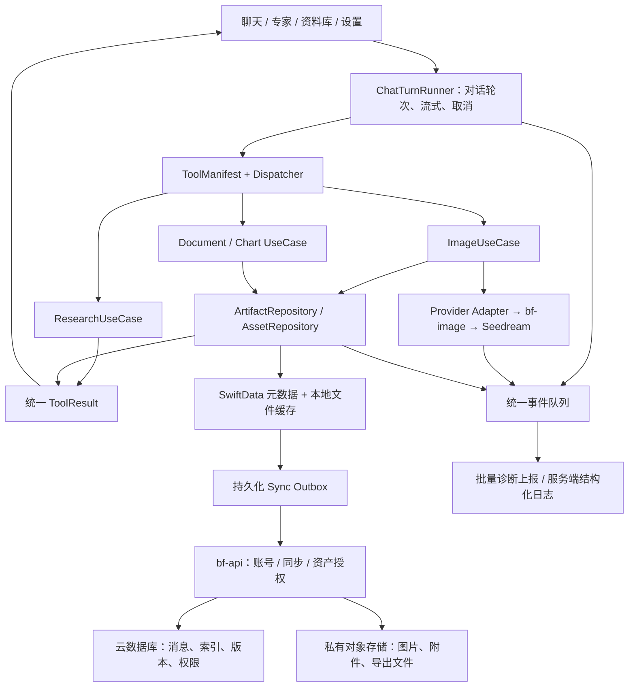

# 架构审查、存储与执行设计

日期：2026-10-27；源码基线 `c662714`。本文是待实施方案，不是“已完成”报告。

## 1. 当前架构与确定缺口

已有底座应保留：SwiftData 本地库、账号归属字段、同步 API、会话删除墓碑、错误 envelope、崩溃上报、工具失败上报、COS 直传凭证、图片幂等/组图任务、尺寸解析和受限网络客户端。

以下结论来自本地源码；没有读取线上个人会话，也没有把本轮静态审查冒称线上复现。

| 编号 | 证据位置 | 已确认事实与影响 | 改造方向 |
|---|---|---|---|
| F01 | `Services/SyncService.swift:348–369` | 序列化消息只有文字、sources、attachmentIds、createdAt、hasImage；没有云端图片 ID、组图数组与 seriesMeta。 | 消息引用统一 Asset/Artifact；同步元数据，不把图片二进制塞数据库。 |
| F02 | `Services/SyncService.swift:267–315`、`Models/Models.swift` | 拉取只恢复文字与附件 ID，没有图片恢复；StoredFile 没有云端对象字段。附件 ID 对另一设备的沙盒文件没有意义。 | 同步附件元数据、云对象键、原/预览/缩略图关系；缺本地文件时从云端补回。 |
| F03 | `Services/SyncService.swift:121–173` | 每轮推送账号所有会话、所有消息；只按条数分批，未按实际字节数分批。会话越长，重复传输越大。 | 本地持久化 outbox，按消息增量推送，兼顾批次条数和字节数。 |
| F04 | `cloudfunctions/bf-api/index.js:1586` | 对完整 JSON 字符串直接截到 400000 字符，可能保存成损坏 JSON；客户端又会对该条解析失败，阻断同步。 | 禁止截断序列化 JSON；旧接口超限明确拒绝，新契约采用消息分页/分条持久化。 |
| F05 | `Services/SyncService.swift:80,182`、`bf-api/index.js:1969,2043` | 客户端用完成同步时的本机 Date 推进游标，服务端按业务 updatedAt 拉取；同步窗口新写入、设备时钟偏移、旧消息迟到均有漏拉风险。 | 服务端维护提交 revision/commit cursor，按提交次序拉取，业务时间不承担同步游标职责。 |
| F06 | `Services/SyncService.swift:267–270`、`bf-api/index.js:1606–1609` | 同 ID 消息本地合并直接跳过；服务器整段会话 LWW 覆盖。已存在消息的修订/产物补齐无法正常传播，多设备整快照也存在互相覆盖风险。 | 消息独立 upsert＋版本/冲突规则；标题和消息修改分开处理。 |
| F07 | `BossAIApp.swift:94–100`、`SyncService.swift:98–113` | 默认触发受“每日 03:00 后”条件控制；发送成功未发现同等级别的持久化增量同步触发。登录视图也未直接发起强制恢复。 | 本地提交时写 outbox，前台适度合并触发；登录、换设备强制恢复；iOS 后台刷新只做补偿。 |
| F08 | `Services/ToolPipeline.swift:171–186`、`bf-api/index.js:4587–4600` | 客户端发送 requestId/errorCode，但服务端工具事件只保存 accountId/tool/reason/platform/ts，且写库失败仍回 ok。 | 完整保存关联字段，持久化回执与离线补报；失败不阻塞主业务，但不能伪造已收取。 |
| F09 | `Services/ToolPipeline.swift:22–42` | 错误回注要求模型只说“这次没做成，可以重试”；这会掩盖额度、权限、参考图缺失与保存失败的不同处理办法。 | 界面按结构化错误直接生成自然文案与动作；模型不自行猜错因，也不一律建议重新生成。 |
| F10 | `Services/PerformanceTrace.swift:46–66` | 动态事件主要留在本地 Logger，慢请求单独上报；慢请求 payload 中出现双反斜杠插值写法，应补测试确认实际值。 | 统一事件字段白名单、分阶段耗时、持久化批量上报。 |
| F11 | `Services/ImageService.swift:217–271` | 参考图直传后只返回临时 URL，fileID 没有作为可复用资产 ID 回到业务模型；重试可能重复上传。 | Upload 返回可持久化 AssetRef，临时 URL 仅用于传输，按需换签。 |
| F12 | `bf-image/index.js:1326`、`runSeriesChild/finishIdem` | 上游主要只取 data[0].url；任务记录使用上游 URL，未见生成结果统一归档到自有对象存储。 | 成功结果先形成完整资产清单和归档状态；长期引用自有 Asset ID。图层走多资产结果。 |
| F13 | `Models/Models.swift:81–128`、`ToolPipeline.swift:61–90`、`LibraryImageWriter.swift:55–79` | 图片既保存在消息 Data/组图 JSON，又作为文件写入资料库；同一产物存在多份本地大对象。资料库去重集合只在内存且未含账号维度。 | 统一文件资产表与引用，账号内持久化去重，旧数据渐进迁移；消息仅保留小缩略图或资产引用。 |
| F14 | `ImageGeometry.swift:31–35`、`bf-image/media-guards.js:65–79` | App 与后端都限定短边至少 512、长边至多 4096，故比例超过 8:1 无法表达；实际调用现有解析器，9:1/1:9 返回 null。 | Provider 输出约束、输入限制、App 解码预算分开；不能把内存防护伪装成模型能力。 |
| F15 | `ChatViewModel+Streaming.swift`、`ToolRegistry.swift`、`ChatService.swift`、`EffectiveToolPolicy.swift` | 工具 schema、说明、权限和执行分发分散；runLoop 仍承载领域流程。现有架构方案的 B/C/D 尚未完成。 | 单一 ToolManifest、Dispatcher、垂直 UseCase；迁移现有实现，不复制一套并行框架。 |
| F16 | `bf-api/index.js:3084–3100`、`bf-image/index.js:1297–1301` | 最新提交在兼容调用中通过不传 optimize_prompt_options 声称关闭优化，主要 bf-image 路径仍显式 standard。官方缺省 mode 是 standard，省略字段不能证明关闭。 | 先画清真实入口与 Provider 契约；统一配置和请求采样验证，不凭注释认定优化已关。 |
| F17 | `bf-api/index.js:883–914`、`handleSyncPush/handleSyncPull/handleFileUrl` | 历史同步和文件换签共用 requireMember，会员到期同样被拒绝；sv 校验还执行另一设备登录后旧会话失效的策略。 | 将账号数据读取与新增付费任务授权分开设计；是否允许多设备同时在线是产品政策，不能为同步绕过 sv 或放开越权。 |

### 本轮实际运行的最小复现

运行的是现有 `image-sizing.js` 的纯计算，无网络调用、无生图费用：

| 输入比例 | 当前 2K 解析输出 |
|---|---|
| 1:1 | 2048x2048 |
| 3:1 | 3544x1184 |
| 9:1 | null |
| 1:9 | null |

`bf-api`、`bf-image` 仍是多业务大入口。重点不是它们“行数大”，而是业务决策、账务、传输和错误规则相互耦合。单纯切成更多文件并不能算架构改善。

## 2. 目标架构：一套执行底座，多个完整能力

边界约束：

1. UI 不选模型、不重新解析参考图；显示业务状态与动作。
2. 前置模型负责理解意图和提出计划；确定性校验器负责参数、权限、尺寸和来源，不能让模型绕过校验。
3. 一份任务计划在生成、重试、保存、同步间传递；Provider adapter 只做协议映射，不再次改写用户意图。
4. 每种能力返回相同的结果类型：成功、部分成功、生成中、待保存、可恢复失败、不可恢复失败、取消。
5. 本地是离线可用缓存；云端负责账号级长期记录。任何“已同步”标记都以真实远端确认作为依据。
6. 保留现有 API 路由和旧客户端适配；先建立边界再逐域迁移，不为拆分立即增加云函数数量或引入常驻服务。

## 3. 统一任务与错误，不强行承诺永不失败

建议持久化任务阶段：`created → validating → running → result_ready → archiving → completed`；并区分 `partial`、`cancel_requested`、`cancelled`、`failed`、`outcome_unknown`。

- `result_ready`：付费模型已经产出；即使归档失败，也不再自动调用模型。
- `archiving`：可以本地展示已有结果，并提示云端保存状态；界面不把归档失败变成“图片生成失败”。
- `outcome_unknown`：请求已送达但无法确定上游是否完成。优先查询/恢复，不能盲目重试并保证“不扣费”。
- 用户关页面或客户端取消，不等于 Provider 任务已停止；服务端如不能取消，应如实记录并处理最终结果。
- 服务端账务和幂等用稳定 jobId/requestId/子任务 ID；写库失败、下载失败与“重新设计一张”是不同操作。
- 不以无限自动重试保证成功。按错误类别设有界次数、总时限、退避和费用预算；429 遵循服务端重试建议。

用户文案示例（由受控错误目录产生，不让模型编造）：

| 真实状态 | 自然提示 | 动作 |
|---|---|---|
| 网络断开 | 网络暂时断开，当前内容已保留。 | 恢复连接 / 重试连接 |
| 同请求处理中 | 图片还在生成，不用再次提交。 | 查看进度 |
| 生成成功，归档失败 | 图片已生成，云端保存暂未完成。 | 重试保存，不重新生成 |
| 找不到指定参考图 | 没有找到你指定的图片，请重新选择。 | 选择图片 |
| 比例当前不可用 | 当前无法按这个比例输出，可以选择…… | 切换比例 / 保留原图 |
| 额度不足 | 当前图片额度不足，这次尚未开始生成。 | 查看额度；仅在确知尚未调用时这样表述 |
| 外部结果不确定 | 暂时无法确认生成结果，正在查询。 | 查询任务，不直接发新请求 |

诊断事件建议字段：`eventId, traceId, requestId, jobId, turnId, accountScope, appBuild, apiVersion, domain, stage, errorCode, retryable, attempt, model, ratio, sourceCount, durationMs, billingState, archiveState, occurredAt`。

客户端本地事件队列有容量和有效期，断网恢复后批量发送；eventId 去重，服务端入库/落日志成功才回执。上报失败不连环触发自身错误事件。聚合首发与重复次数，避免刷屏。日志字段使用白名单，不上传 token、签名 URL、原始图片、完整聊天或敏感业务文案。需要原素材复现时作为用户明确提交的反馈附件处理。

## 4. 聊天与产物云存储

### 数据实体（先沿用现有文档数据库，非立即迁库）

| 实体 | 保存内容 | 不保存内容 |
|---|---|---|
| Conversation | 账号、标题、专家、摘要、版本、删除标记 | 全量图片二进制 |
| Message | 稳定 ID、role、正文、sources、顺序、版本、附件/产物 ID | 整段会话快照中的所有图片 |
| Artifact | 与消息/资料库/任务的关系、类型、组图顺序、图层清单 | 临时 URL 作为永久地址 |
| Asset | owner、objectKey/fileID、MIME、宽高、字节数、hash、原图/预览/缩略图关系、状态 | Base64 大字符串 |
| Job | 执行阶段、参数版本、计费/归档状态、产物 ID、错误 | 无限期保留的中间大图 |
| Outbox（本地） | 待同步操作、幂等 ID、基线版本、重试次数 | 未确认就被清空的更新 |
| ChangeFeed（云端） | 服务端提交序号/游标、实体 ID、版本、墓碑 | 以本机时间代替提交次序 |

### 成功到云端可恢复的完整过程

1. 上传附件：复用已有授权直传，返回 AssetRef；先登记 pending，完成后校验对象类型、大小、hash、归属，再 ready。签名权限和路径最小化。
2. 模型返回：先持久化结果清单及归档任务，下载到自有对象存储；不只保存短期供应商链接。
3. 归档失败：保留可重试记录与本地结果，有限重试/对账；不通过 HTTP 返回后的未等待 Promise 假装有可靠后台任务。异步处理必须有持久队列/任务触发保障。
4. 消息、资料库索引、任务和账务通过稳定 ID 关联；上传完成但未关联的对象进入孤儿扫描宽限期，不马上删除。
5. 客户端收到资产 ID，先缩略图，打开预览再加载预览或原图。临时签名过期只换签，不重新生图。
6. 客户端本地合成的精确文字成品同样要归档；不能只保存服务端无字底图。底图、成品、图层 manifest 各有明确角色。
7. 用户新设备登录：拉会话目录 → 分页拉消息 → 下载屏幕需要的缩略图 → 用户点击再取大图。资料库和消息引用同一个资产。

官方返回的生成 URL 有效期为 24 小时。新流程必须及时归档；历史 URL 已过期且没有任何设备本地副本时，不能承诺恢复原图，也不能用重新生成冒充原作品恢复。

### 同步正确性

- 本地保存与 outbox 记录尽量处于同一持久化边界，避免“消息存了却永远没排队”。
- 云端用提交次序/版本游标；分页基于固定水位，全部落地确认后推进检查点。只把返回的 serverTime 替换 Date 并不能修复按旧业务时间查询的迟到写入问题。
- 会话标题与独立消息分别处理；消息新增按 ID 合并，更新按版本；同 ID 冲突不能仅看客户端时钟。删除采用墓碑与版本规则，保留合理恢复窗口。
- 同步期间固定账号会话快照，账号切换取消旧网络任务；提交前再核对 owner，避免 await 过程中 token/账号被换掉。
- 登录先恢复目录，同时补推本地 outbox；长对话消息分页。不能让一次大 push 的失败阻塞全部历史下载。
- 切回前台采用节流合并触发，后台任务只是补偿，不依赖“每天某时一定运行”。
- 建议到期会员仍可读取/导出本人已保存的数据，新增付费生成继续受会员与额度约束；停用账号、撤销凭证和对象归属校验仍严格生效。这是待明确的产品授权规则，不是本轮改动。
- 现有系统是新设备登录使旧 session 失效。默认保留此政策；两设备恢复先做先后登录与离线分叉测试。如产品决定允许同时在线，应独立实现设备 session 撤销机制，不能直接删 sv 校验。

### 历史迁移

新增可选字段/模型版本，先双读新旧格式，不立刻删 `imageData` 和 `extraImagesJSON`。扫描当前设备仍有的原图与文件，按账号登记上传；服务端确认并做 hash 校验后，再允许回收重复本地大对象。备份文件恢复沿用原 owner/显式跨账号恢复规则。跨设备已无图片但仍有 hasImage 的记录明确显示“旧版图片尚未备份”。

## 5. 成本设计：先消除重复，再考虑压缩

对象存储承载文件，数据库仅存文本与索引。不要把全部图片压成 Base64 放数据库：编码体积通常增加约三分之一，也放大会话同步和读写成本。

| 成本来源 | 方案 | 保护边界 |
|---|---|---|
| 重复文件 | 同账号按 hash＋变体规格去重；消息/资料库/组图均引用同一个 Asset | 不做跨账号存在性探测或暴露他人内容的全局去重 |
| 列表流量 | 约 320–480px 缩略图，预览按需，原图点击下载；内存/磁盘缓存有界 | 超宽图保持比例，列表可限展示高度，打开看完整图 |
| 图片体积 | 照片预览选 JPEG 等平台实际支持的高效格式；密集文字预览保清晰度，透明图层用 PNG | 先测真机兼容性；不反复重压原图，不丢透明通道，不牺牲已承诺成品质量 |
| 服务端流量 | 客户端用有时效的授权 URL 直传/直下对象存储；云函数主要做签名和元数据 | 供应商结果归档仍可能消耗服务端下载/上传，纳入单次预算；不开放匿名整桶读 |
| 同步读写 | 增量 outbox、目录/消息分页、批量确认，索引匹配账号与游标查询 | 不每次登录全量下载原图，不每次推整段历史 |
| 临时数据 | 建议临时上传 24–72h、未引用中间图 3–7 天后清理；终态任务详情与诊断按策略分层 | 均为待实施建议，不能直接套到已保存作品、账务记录和未完成任务 |
| 日志 | 错误聚合与限流，成功事件采样；建议详细技术日志 7–14 天、必要聚合指标保留更久 | 财务/审计数据另定保留期，不跟调试日志一起删除 |
| 冷数据 | 观测访问频率后再考虑低频或归档 | 低频有取回费/最短时长；历史聊天要即点即看，不宜默认深度归档 |
| 模型费用 | 归档重试不生图；复用用户授权可复用的素材；质量通过后再启用 Pro/Flash 路由 | 不把实际编辑任务缓存成另一张“近似图”，不静默降级 |

保留建议需在实施配置中明确告知。删除策略先审计与 dry-run，引用关系及 grace period 校验后执行；孤儿清理使用标记—核对—删除，防并发上传/恢复期间误删。

成本用量公式：

`月费用 = 存储 GB·月 + 下载/分发流量 + 请求次数 + 数据库读写/索引 + 函数资源 + 图片处理 + 模型调用 + 冷数据取回（如启用）`。

示例仅为容量测算：10 万张作品，每张原图 1.5MB、预览 0.15MB、缩略图 0.03MB，约 168GB（十进制）。实际账单还取决于访问次数、所在地域、CloudBase 套餐及服务路径；本轮未查询账户账单，不给虚构人民币报价或保证节省比例。

先观测每位活跃用户存储量、每张图平均下载次数、缩略图命中率、重复上传率，再设预算和告警。高并发或低频存储都不是当前默认前提。

## 6. 图片能力：原生优先，业务约束清楚

### 三条主路径

| 路径 | 前置模型职责 | Seedream 请求 | 可选扩展 |
|---|---|---|---|
| 文生图 | 整理用途、必要文字、风格、禁止项及画布需求 | 简洁 prompt＋size＋官方 standard | 用户要求精确文案时才进入核对/排版 |
| 局部编辑 | 选准原图，分清修改范围与需保留内容 | 原图＋简洁编辑指令；有真实定位时带 point/bbox | 原生图层编辑；不凭空臆造坐标 |
| 参考重设计 | 提取保留的主题/文案/品牌与重做的风格/布局 | 参考图＋重设计指令＋明确画布 | 风格参考、精确文案恢复 |

不增加通用的第二次 prompt 美化 LLM。审美参考仅在需要设计规划时注入，不让每次普通聊天都重复承载全部样式库。JSON 用于 App 内计划与工具契约；传给 Seedream 的 prompt 仍按官方自然语言协议，不能把强制 JSON 等同于模型审美提升。

Pro 的提示词优化不等于它会替 App 自行调用任意外部 LLM 或决定整个工作流；复杂文案补全、是否允许裁切、可接受费用和附件选择依然属于产品语义。

### 比例和输出尺寸

- 普通灵活创作：可采用官方推荐的 size 档位＋简洁用途描述，由模型自适配；必须验收实际输出。
- 用户明确 1:1、3:1、9:1 等比例：计划中记录精确 ratio，编译为满足该 Provider 像素预算的显式 WxH，并校验结果；不要仅靠 prompt 祈求比例。
- 编辑：默认继承源图比例，区分“换风格”和“换画布”；修改画布并不自动授权裁掉原内容，需表达扩图/重构/裁切策略。
- 官方 Pro 输出总像素为 921600–4624220、比例范围 1/16–16；9:1 属于范围内，但当前 App 自设边长预算挡住了它。需要修复客户端、服务端、预览、下载、解码、缩略图的整条契约，不只放开一条校验。
- 例如 3456x384 为 9:1、1327104 像素，处于官方像素范围内，是待真实接口验证的候选，不在本轮声称实测通过。需要更高细节时选择同预算下更大长边，并用下采样控制 UI 内存。
- 比例只证明画布，不证明脸、边缘、主体位置保持。固定图片真实回归仍必需。

### 组图与图层

组图继续使用单图子任务编排，稳定子任务 ID、共享必要参考、单张失败单张恢复；原生 Pro 不支持 sequential_image_generation 不等于 App 不能组图。

图层独立返回 `LayerManifest`：底图 Asset ID、每层 Asset ID、z_index、bounding_box、name、description。只有全数组解析、归档、预览、导出、重登恢复都完成后才开放工具；保持 PNG alpha，不能压 JPEG。该能力排在核心三路径与持久化之后。

### 混合路由和审美

质量评测保持 Pro，先建立一份覆盖所有任务的能力矩阵。将来路由按保真约束、文字精度、编辑复杂度、最终交付/草稿、成本偏好和模型能力决策；不用“海报一律 Pro/某词一律 Flash”等粗规则，不做失败后无提示自动降级。对比固定素材多次结果，统计任务通过率、耗时和真实费用；未确认 seed 参数时不依赖它实现确定性。

## 7. 全 App 改造范围与迁移方法

| 域 | 保留与收敛 | 验收重点 |
|---|---|---|
| 登录/会员/额度 | 保留现有登录与账务规则；会话上下文不可变，权威额度在服务端 | 过期登录、断网、切账号、额度不足无串号和假扣费文案 |
| 聊天/流式 | ChatTurnRunner 只管轮次、流式、取消、结果持久化协调 | 断流、重试、后台恢复不重复插消息、不丢用户输入 |
| 搜索/研究 | 迁到 ResearchUseCase，继续使用已有证据与来源解析 | 搜索失败不伪造引用、证据不足明确显示 |
| 文档/表格/图表 | 复用已有 Builder/Renderer，共用 ArtifactRepository | 文件实际可打开、资料库与历史引用一致、失败不假报成功 |
| 附件/OCR | 资产导入统一，OCR 是独立可调用能力 | 大文件、损坏图、识别疑点不导致整个对话崩溃 |
| 图片/组图/图层 | 复用 Resolver/Planner/Compiler，统一结果与资产接口 | 正确图片来源、尺寸、计费、归档、重试与恢复 |
| 记忆/档案/专家配置 | 明确本地/云端字段、版本与删除规则，补未知 kind 的兼容策略 | 不因 file/profile 新类型令老客户端全轮同步失败 |
| 定时任务 | 先核验哪些仍靠前台补偿；承诺离线执行的才迁到可靠服务端调度 | 不能把 iOS 机会式后台刷新说成准点执行 |
| 后台/运维 | 保留管理端契约；增加按 trace/job 的脱敏检索和任务状态 | 能区分模型失败、账务待对账、保存失败、同步失败 |

先实现协议与逻辑边界，再在适当阶段拆 Swift package/target，避免一上来多模块循环依赖。后端 router 按 auth/account/chat/sync/assets/billing/admin 分域，`bf-image` 按任务、Provider、账务、资产归档分域；共享 error/logger 通过构建打包保持一致，不依赖跨云函数运行时目录。

旧 poster renderer、旧路由、旧字段、旧同步接口的删除要以调用图、旧版支持窗口和线上访问记录为依据。迁移采用新写＋双读、对账、可回滚，禁止“grep 某文件为零”就全局删代码。

## 8. 官方依据与不确定性

1. [Seedream Pro API](https://docs.volcengine.com/docs/ark/image-generation-api?lang=zh&redirect=1)：尺寸、standard/fast、24 小时结果 URL、图层数据。遗漏 optimize 字段不是已验证的禁用开关。
2. [Pro/Flash 教程](https://docs.volcengine.com/docs/ark/seedream-5-0-pro?lang=en)：交互编辑与图层能力。原生能力不能替代客户端完整结果消费。
3. [CloudBase 文件恢复模式](https://docs.cloudbase.net/recipes/add-file-upload-wechat-miniprogram)：持久化 fileID、临时 URL 到期重签。引用其存储模式，不使用小程序 SDK 实现原生 iOS。
4. [CloudBase 管理 SDK 云存储](https://docs.cloudbase.net/api-reference/manager/node/storage)：签名/下载链接与权限能力；复用本项目已有服务端 HTTP 边界。
5. [COS 成本优化](https://cloud.tencent.com/document/product/436/50201)、[生命周期](https://cloud.tencent.com/document/product/436/56548)：成本含读取/取回/请求，低频/归档存在最低时长和计费限制，不能只看 GB 单价。

尚未验证：当前线上资源套餐/账单、全部历史图片可恢复比例、9:1 真正调用效果、旧 App 活跃版本分布、云函数各接口线上流量。实施前只读核验这些事实，不擅自建永久密钥或更改账号权限。
